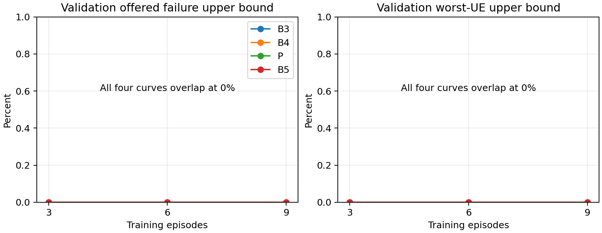

# Phase 2C-1: paired pilot decision report

Branch `phase2c1/paired-training-pilot`; base `ed267de`. The commit containing this report is the implementation commit on that branch. **The pipeline is validated, but this pilot does not establish a deadline-performance advantage for joint learning.** No further training or full journal sweep was launched.

## What changed and what was audited

The Phase 2B state/action/reward/replay audit is in [AUDIT.md](AUDIT.md), written before training. The 30-feature definition, validity/exposure masks, 98-action order, reserve-return constraints, exactly-once failure union, terminal administrative charges, worst-UE risk and switching penalty remain unchanged. Physical reserve is fixed at 18 PRBs. Original CSVs, budget assignment, radio/channel/jammer and both schedulers are unchanged.

A new sequential runner separates network seed from scenario seed, resets a fresh single-entry simulator for each paired scenario, and supplies all seven controllers. The original source 15-input/49-output DQN network, encoder and reward are reused for B3/B4/B5. It retains original MSE loss/no clipping; P retains Huber/norm clip 10. The existing generic agent gained dimension/network/loss hooks, explicit epsilon selection and read-only TD/Q diagnostics. Default Phase 2B behavior and checkpoint schema are compatible; committed-smoke equality verifies this.

The watchdog now supports lower warning/stop thresholds, checks system memory pressure, and monitors descendants even when they start a new session. Only its launched workload is terminated. This Python build omits pidfd support; tracked-PID/group fallback was tested using a deliberately small nested-session worker. A NumPy-before-PyTorch bootstrap fix resolves the installed MKL/libgomp subprocess import conflict. No system-wide setting or other training process was altered.

## Frozen learning and selection protocol

| Item | Actual protocol |
|---|---|
| Training scenarios | Seeds 1101,1102,1103 × j0,j10,j20; seed-major order |
| Validation scenarios | Seed 2101 × j0,j10,j20 |
| Held-out scenarios | Seeds 3101,3102 × j0,j10,j20 |
| Network/exploration/replay seed | 12026; one independent learner per learned method |
| Episode duration | 300 × 10-ms intervals = 3 s, including 10-ms initialization |
| Training per B3/B4/B5/P | 9 episodes, 2691 transitions, 2660 optimizer updates |
| Optimizer | CPU Adam 1e-4; batch 32; replay capacity 2048 |
| Discount / target update | gamma .99 / every 100 optimizer updates |
| Exploration | Linear 1→.05 over first 80% of fixed transition budget, then .05 |
| Candidates | Episodes 3,6,9; greedy validation, epsilon zero |
| Checkpoint criterion | Minimum mean failure upper bound; then worst-UE upper bound; then maximum eMBB Mbps; then earlier episode |
| B5 rule | Entry HOL/budget>.75; release at <=.375 for two decisions; missing pressure holds mode |

The rule candidates .75/1.25 were evaluated using selected B3 weights on validation only, then frozen before B5 was independently trained. Every validation checkpoint/rule candidate had zero failure lower/upper bounds and 96 Mbps. All learners therefore selected episode 3 by the preregistered tie-break. **Held-out models have 897 transitions / 866 updates**, although every complete training run used 2691/2660. The selected models have only seen training scenario seed 1101. This is an important limitation of the flat selection criterion, not evidence that 897 transitions are sufficient. B5 was trained separately, but its selected episode-3 reserve parameters are identical to B3's: the rule did not alter those easy early trajectories. Its later training differs, but those later checkpoints were not selected. Thus the held-out B5 comparison does not exercise useful switching.

The run contains 36 training episodes, 36 checkpoint-validation episodes, six rule-validation episodes and 42 held-out episodes. Training/validation/test splits are disjoint. Complete exogenous/deadline fingerprints match across every controller pair. Initial activated reserve is zero throughout; initial local mode is fixed F for B2/B4 and P for the others. Initialization is excluded from replay and included in every physical metric. No held-out result changed seeds, weights, rules, selection or budgets.

## Software validation

- Full suite: **85 passed in 89.75 s**, comprising the previous 78 tests and seven new protocol/controller/watchdog cases. Seven focused tests were rerun after final watchdog/configuration changes: **7 passed in 6.57 s**.
- Real short checks cover all seven controllers, actual updates under both schemas, evaluation without parameter changes, deterministic fresh resets, exogenous/deadline pairing and B1/B2 identical reserve trajectories. Mask/atomic/causal/reward/TD checks from earlier phases remain passing.
- Historical checks: **6/6 Phase 0** and **18/18 Phase 1** saved hashes match; both fixed-policy equivalence pairs match; Phase 2A scripted replay and its committed digest match.
- Committed Phase 2B smoke: exact trajectory, final network parameters, loss sequence and reward match after generic agent changes.
- A small 64-MiB nested worker validates watchdog warning and termination without approaching the actual 3-GiB ceiling. No production workload reached the warning/stop thresholds.

Earlier test attempts exposed the MKL import-order issue and unavailable pidfd API; both were corrected and retested. Actual reports, including those attempts, remain in `resource_reports.json`. `test_results.txt`, `regression_summary.json` and `provenance.json` contain the evidence. Historical reproduction is limited to these named scenarios, not every published experiment. The complete four-learner protocol was run once; independent bit-for-bit repetition of that entire training run was not performed. Commands, deterministic CPU settings, splits and selected checkpoint hashes are recorded for reproduction.

## Learning behavior and convergence

| Learner | Episode return mean ± population SD | First/last episode mean loss | Last episode maximum valid absolute Q |
|---|---:|---:|---:|
| B3 | -1611.41 ± 2280.76 | 5.8052 / 66.9984 | 61.057 |
| B4 | -1660.31 ± 2262.00 | 5.8052 / 44.4529 | 85.867 |
| B5 | -2944.89 ± 4649.51 | 5.8052 / 151.1424 | 100.771 |
| P | -27.397 ± 42.410 | .002266 / .008770 | .9383 |

These returns have different objectives/scales and must not be ranked across legacy and joint learners. Their variability mixes changing scenario seeds/severities with learning and exploration; it is not uncertainty across independently trained networks. All updates/losses remained finite. Larger later losses coincide with harder scenario seed 1103, so they alone neither prove divergence nor demonstrate convergence. No stable performance plateau can be established from nine ordered episodes and nondiscriminating validation.

The figure averages the three severities of the single validation seed. All curves overlap at zero; it shows insufficient selection information, not four converged or equally generalizable controllers. `learning_diagnostics.json` and the full episode records provide Q magnitudes, TD error, returns, valid-action fractions, selection frequencies and physical outcomes separately.

## Held-out paired pilot

Every number below averages the same two held-out scenario seeds. **For every method and severity: aggregate known failure=0%, tight-class failure=0%, relaxed-class failure=0%, worst-UE known failure=0%, eMBB=96 Mbps, and served/offered eMBB bytes=1.** No observed overflow or late batch completion distinguishes the methods.

| Method | Mean activated reserve: j0 / j10 / j20 | URLLC F service fraction: j0 / j10 / j20 |
|---|---|---|
| B0: no activation/P | 0 / 0 / 0 | 0 / 0 / 0 |
| B1: reactive/P | 0 / 5.843 / 10.413 | 0 / 0 / 0 |
| B2: reactive/F | 0 / 5.843 / 10.413 | 1 / 1 / 1 |
| B3: retrained original/P | 9 / 9 / 9 | 0 / 0 / 0 |
| B4: retrained original/F | 9 / 9 / 9 | 1 / 1 / 1 |
| B5: retrained original + rule | 9 / 9 / 9 | 0 / 0 / 0 |
| P: joint | 5.513 / 6.048 / 8.023 | .975 / .9667 / .9617 |

Both seed-specific observations, not just their averages, have zero known failures. The full 21-row table and per-class results are in `pilot_table.csv`/`pilot_summary.json`; `paired_differences.json` and `per_ue_differences.json` contain paired, individual comparisons. No confidence interval, significance or generalization claim is warranted from two scenario seeds and one trained network seed.

Censoring matters even here:

| Method | Offered-failure upper bound (%): j0 / j10 / j20 | Worst-UE upper bound (%): j0 / j10 / j20 |
|---|---|---|
| B0 | 0 / .004167 / .016667 | 0 / .016667 / .033333 |
| P | 0 / 0 / .006250 | 0 / 0 / .033333 |
| B1–B5 | 0 / 0 / 0 | 0 / 0 / 0 |

Upper bounds count current unresolved-not-yet-due traffic as potentially failing. Lower bounds count only known failures. Administrative terminal reward charges are not observed deadline misses. The very small horizon differences above do not demonstrate better actual deadline completion. All methods use the same three-second horizon and no draining.

Each jammed severity has two OFF windows, one per seed. Every method is compliant from the OFF transition and satisfies the 10-ms recovery hold with recorded delay 0 s (2/2 successes at j10 and j20). No-jamming recovery is N/A. Because no measured deadline failure occurred during jamming, this does not establish a superior recovery mechanism.

## Per-UE fairness and workload coverage

All 48 held-out UE/scenario combinations have zero known failure for every controller, so there is no observed worst-UE degradation or fairness improvement to attribute. Individual PRBs, capacity, served bytes, unresolved bytes and failure differences are retained. Zero observed failures are not packet reliability or industrial end-to-end guarantees.

Coverage is the main problem. Validation baseline-relative offered-fluid load is .764/.788/.814 for j0/j10/j20. Held-out ratios range .845–.947 across the two seeds and severities; all are below one. Training ranges .879–1.038 and includes a harder seed 1103 absent from validation. These are baseline-relative fluid diagnostics; rounding/deadline heterogeneity matter, and reserve can increase attainable capacity. The pilot covers a feasible-to-near-capacity original workload, not a controlled overloaded held-out regime. Existing Phase 1.2 regimes require scaled traces, excluded under the instruction to preserve traffic.

A useful **training diagnostic**, not a greedy held-out comparison, is the last seed1103/j20 episode:

| Learner during exploration/training | Aggregate known failures | Worst-UE known failures | Mean reserve |
|---|---:|---:|---:|
| B3 | 61.98% | 75.43% | 5.487 |
| B4 | 8.98% | 71.83% | 8.920 |
| B5 | 10.88% | 87.00% | 5.357 |
| P | 29.25% | 50.17% | 11.163 |

This shows a potential aggregate/fairness tradeoff in challenging **training** conditions, not an advantage of the selected checkpoint. For example, under B5 the tight UE1 gets mean 4.10 PRBs/tick against offered-fluid need 6.84 at 95.03 bytes/(PRB tick), and fails 87%; the same UE has zero failures with mean 6.99 PRBs under B4. B4 instead has 71.83% failures for tight UE7, while its other seven UEs have zero. P's worst failure is 50.17% but failures are spread across more UEs. Channel capacity is nonzero, and policy combinations expose different service deficits. Mean grants alone do not prove a deadline-feasibility certificate or identify scheduling versus reserve causation. The policies, exploration and resource trajectories differ, so these rows cannot isolate a learning mechanism.

## Answers about joint learning

1. **Outperform original DQN/P?** No demonstrated deadline or throughput advantage. P uses less reserve than B3 in these runs.
2. **Outperform original DQN/F?** No demonstrated deadline or worst-UE advantage. Again, reserve is lower than B4's 9 PRBs.
3. **Outperform causal rule switching?** No demonstrated deadline advantage over B5. Its rule never switches on these held-out conditions, and P's policy is nearly fixed F.
4. **Aggregate improvement at a worst-UE cost?** Not observed in held-out data because all known-failure rates are zero. Training shows a different tradeoff, which requires a harder, separately specified evaluation.
5. **Substantially more reserve?** Less than the retrained DQNs (5.51/6.05/8.02 versus 9), but unnecessarily more than B0. Compared with reactive control, P uses more at j0/j10 and less at j20. No Pareto claim follows given horizon uncertainty and untested service metrics.
6. **Excessive switching?** Greedy P averages 6/3/4 switches over three seconds at j0/j10/j20: 2.01%/1.00%/1.34% of decisions. This is not rapid 10-ms chattering, but its benefit is unproven; real switching/transport overhead is not modeled.
7. **Consistent improvements across severities?** There is no demonstrated deadline improvement at any severity.

The evidence cannot distinguish insufficient optimization from reward/observation limitations or a lack of useful joint decisions on hard held-out conditions. The strongest measured explanation for the uninformative pilot is **easy validation/test coverage and flat checkpoint selection**. The selected policies have not seen harder training seeds. Absolute worst-risk shaping, the 100-ms mixed-policy history, terminal shaping and partial observability remain legitimate concerns; this pilot does not establish them as causal defects. Comparisons also intentionally change reward/state/loss between P and the mandated original DQN baselines, so a future advantage would not by itself isolate the value of joint actions.

## Runtime and resource use

| Work | Measured wall time |
|---|---:|
| Training + all checkpoint/rule validation, one sequential process | 273.31 s (stage); 275.11 s including bootstrap/guard |
| Held-out 42 episodes | 129.82 s (stage); 131.60 s guarded command |
| Training loops alone B3 / B4 / P / B5 | 29.64 / 36.87 / 35.22 / 33.40 s |
| Full passing pytest suite | 89.75 s |

Assigned logical CPUs: **6,8,9,15**, selected from a current per-core utilization sample. `sched_setaffinity` is inherited by all children; numerical-library safeguards and PyTorch use one thread. Training/evaluation are sequential, with one active worker and zero DataLoader workers. CUDA visibility is empty and every episode checks CUDA remains uninitialized.

Across all guarded commands, maximum sampled aggregate resident memory is **1.5165 GiB**, and maximum sampled CPU utilization is **138.70%**, where 100% equals one logical CPU. Training/validation peak is .711 GiB; held-out peak .696 GiB. All are below the 2-GiB warning threshold and 2.5-GiB stop threshold. System available RAM was checked initially and during workloads; the stop threshold is 4 GiB available. No production memory stop, full-training escalation, parallel sweep or GPU job occurred. No requested controller was skipped.

**RAM is monitored, not hard-capped:** no writable delegated cgroup is available. The watchdog samples aggregate process-tree RSS plus itself every 50 ms, conservatively double-counting shared pages; short peaks can be missed. The deliberately small watchdog unit test stops its own worker as intended. The complete resource records include failed test attempts and final passing runs, with explanations, in `resource_reports.json`.

## Recommendation before a full journal evaluation

Do not scale this exact protocol directly into the journal experiment. First preregister a representative scenario split using **exogenous** channel/capacity/arrival diagnostics, not policy performance: include nominal, genuinely contested, recoverable jammed and unavoidable-overload conditions across separate train/validation/test pools. With the current no-trace-change restriction, placement seeds can define such strata; any use of the existing scaled-trace regimes needs explicit scope approval. Keep deadline assignments independent of channels.

Choose a validation criterion that can distinguish checkpoints and specify resource/switching tie-breaks before observing new test data. Add reserve-only and switch-only ablations with P's same 30-state observations, deadline reward, loss, capacity and training budget to isolate joint action value; retain original-objective B3/B4/B5 as complementary references. Use a few independently trained network seeds with paired scenario seeds and fixed episode/accounting conventions before drawing performance conclusions. Quantify worst-UE/service deficits, class outcomes, reserve use and recovery under genuinely impaired conditions. Reassess training curves before authorizing more transitions; do not solve nondiscriminating validation by blindly increasing budget.

The industrial claim also needs application-grounded queue/end-to-end requirements and workload justification; the current synthetic batch simulator alone cannot establish industrial process reliability. Keep four-CPU, CPU-only, below-3-GiB safeguards for any subsequently authorized work. **The paired pilot is complete; no further Phase 2C training has been started.**
