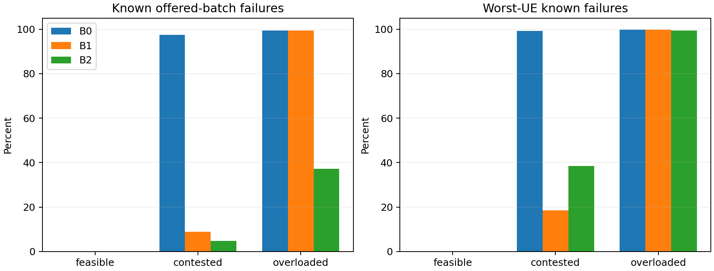

# Phase 2C-2 diagnostic decision report

Branch `phase2c2/workload-feasibility-design`; base `b2007c3`. The implementation commit is the commit containing this report. **Final v2 scenario design passes all 18 coverage gates and is ready for a bounded same-state/same-reward ablation experiment.** This does not establish joint-DQN superiority, convergence or industrial reliability. No model was created, loaded, evaluated or trained in this phase.

## 1. Why the old held-out workload was easy

The physical model did not become less jammed. Severe jamming still reduces the 60-PRB URLLC baseline to 54; moderate jamming gives 57. The physical reserve remains 18. Source traffic remains synchronous 650-byte batches/UE/ms, with fixed 2-ms/10-ms budgets. Actual usefulness depends on the eight UE channel efficiencies, individual budgets, integer grants and resulting FIFO histories, not just an aggregate traffic ratio.

Representative C1 profiles from the existing records:

| Pool/seed | Offered-fluid demand, PRBs/tick | Fresh-batch integer requirement | Severe-jam finding |
|---|---:|---:|---|
| Training1101 | 52.767 | 57 | P training known failures 0% |
| Training1102 | 54.160 | 58 | P training 2.342% |
| Training1103 | 58.503 | 63 | P training 29.246%; difficult per-UE tradeoffs |
| Validation2101 | 45.860 | 52 | Every greedy candidate had zero failures |
| Held-out3101 | 50.698 | 57 | No-reserve B0 known failures 0% |
| Held-out3102 | 53.360 | 59 | No-reserve B0 known failures 0% |

Validation2101 has a constructive one-tick URLLC capacity condition even at the 54-PRB severe baseline (integer demand52). Neither old held-out seed has that one-tick construction at54, so their fluid demand below54 alone is **not** a deadline proof. Their measured zero failures show that, for this finite periodic workload, grants and 2/10-ms FIFO budgets absorbed rounding without missed batches. Both maintain 96-Mbps eMBB; only a few not-yet-due batches remain right-censored at the horizon. Old validation was easier than the harder training conditions and could not discriminate checkpoints.

Previous Phase 1.1 harm cases used less favorable per-UE rates and fixed URLLC quotas63/60/57 (including three activated reserve PRBs), often with five-second horizons rather than three. In the saved no-jam seed4004 case, fluid demand63.038 and integer requirement67 competed for quota63; one relaxed UE's feasibility-scheduler failure rose to75.10%. The finite five-second necessary bound did **not** prove those failures unavoidable. Its observed service-rate deprivation was an allocation issue on top of very small aggregate slack, not a zero-capacity channel. Other saved cases did violate necessary bounds. Phase 1.2's scaled regimes also intentionally increased demand and retained the fixed three-PRB activation. Those conditions cannot be pooled with C1's different channels, horizon and adaptive reserve behavior.

The old Phase 1.2 "overloaded" load around65.5 fluid PRBs/tick exceeded its fixed63/57 quotas. It does not prove overload for every current controller: all18 reserve PRBs could optimistically give URLLC72 during severe jamming or78 OFF. The new overloaded regime is defined against that stronger upper capacity.

`prior_workload_audit.json` preserves channel/position/budget, demand, actual grants, unused capacity, per-UE/class outcomes, unresolved traffic and recovery for the old cohorts and historical harm examples. Queueing budgets were not relaxed to obtain the old easy results. Constant channels from frozen mobility are a model restriction, not evidence of resilience to fast fading.

## 2. Seed-independence correction and retired discovery

Source inspection found a more fundamental diversity issue. At episode index zero, registration uses:

`UE_seed = scenario_seed + 100000 + slice_index*1000 + UE_index`.

Adjacent scenario seeds share14/16 registration seeds. Direct coordinate checks show C1 seeds3101/3102 share7/8 URLLC positions: nine unique URLLC positions rather than16 across those two cases. The scenarios are not identical—UE labels/budgets and some positions differ—but they are correlated geometry realizations. Distinct integer seed labels did not establish independent placement replicates. Paired within-scenario comparisons remain measured observations; prior independent-seed language and uncertainty assumptions for affected consecutive-seed cohorts require reassessment. This report does not generalize that finding to uninspected published experiments.

My initial C2 plan also used adjacent base seeds. I missed this in the first seed-plan audit, then caught it in source/coordinate checks. That preliminary v1 plan was retired, its in-progress reference job interrupted after149 complete records, and its results excluded from the final study. No candidate/model advantage motivated the change. The retired protocol and audit are preserved; no learning occurred. The additional diagnostic work is disclosed rather than treated as independent final evidence.

Final **v2 uses actual scenario_seed=4096×candidate_index**, preserving the original radio and initialization code. All72×16=1152 derived registration seeds are verified nonoverlapping, including cross-slice streams and 32-bit wrap checks. This removes exact stream reuse; it does not prove real-world representativeness or mathematical independence of all simulated phenomena. Fresh single-entry catalogs retain canonical UE IDs and episode index zero. The future learning consumer must preserve that contract or repeat the stream audit.

## 3. Operating regimes and independent pools

The final72 short exogenous probes found original-trace candidate counts:

| Pool, candidate indices | Feasible | Contested | Full-pool overloaded |
|---|---:|---:|---:|
| Training12001–12024 | 5 | 5 | 0 |
| Validation13001–13024 | 6 | 6 | 0 |
| Future-model holdout14001–14024 | 6 | 9 | 0 |

This bounded screen does not prove that no overloaded original-trace seed exists elsewhere. It supplies original feasible/contested coverage; overload therefore uses the explicitly authorized Phase 1.2 scaling mechanism on separate CSV copies. No source CSV was overwritten.

Let b_i be bytes/(PRB tick), L be constant offered bytes/UE/tick and dt=1 ms. Fresh-batch integer requirement is C=sum ceil(L/b_i); fluid demand is A=sum L/b_i. For a T-tick interval, count arrivals strictly due before its end as n_i=max(0,ceil(T-D_i/dt-epsilon)-1). Required optimistic work is W=sum n_i*L/b_i. If W>Q*T, zero misses are impossible even with fractional PRBs and no inherited backlog. Equality-at-end traffic is conservatively excluded. A nonpositive bound is **not** a feasibility proof or an optimal failure rate.

| Regime | Prespecified definition | Final fluid demand range | Integer requirement range | Source |
|---|---|---:|---:|---|
| Feasible | C<=54 | 36.991–51.687 | 41–54 | Original650-byte trace |
| Contested | W(1249)>54×1249; C<=72; A<60 | 55.545–59.296 | 59–64 | Original650-byte trace |
| Overloaded | W(1250)>78×1250 | 85.700–85.772 | 88–91 | Six labeled scaled copies,819–1106 bytes |

The one-tick construction requires positive static rates, one batch/UE/ms and no additional per-UE cap; those assumptions were checked at every selected service tick. It establishes a URLLC resource-layer construction from empty queues at the stated quota, not a guarantee for an arbitrary scheduler, inherited backlog, a delayed RIC command, eMBB throughput, or industrial end-to-end latency. Contested OFF fluid headroom does not prove recovery within one OFF window. The overload bound proves some failures unavoidable even with the entire reserve assigned to URLLC; it does not identify which UE should fail or excuse the observed failure percentage as optimal.

Two placement seeds/regime/pool were selected by exogenous criteria in ascending order, with no proposed-model input. All18 placement seeds,54 j0/j10/j20 configurations and manifest hashes were frozen **before** full reference characterization and not replaced based on results. Feasible/contested use12 original-trace placement seeds; six overloaded seeds use generated length-scaled copies. Every non-length field, timestamp, budget assignment, channel and jammer setting is preserved. Uniform regime/severity weighting is a synthetic stress design, not industrial prevalence.

The three manifests are reproducible future pools, not a new training budget. Each has six independently initialized placement scenarios and18 severity/configuration entries. Future holdout is **reference-characterized but model-unseen**, not untouched blind test data. No DQN was inspected before or after freezing. Model tuning from later holdout results would violate the intended split; publication-level generalization needs an independently preregistered untouched evaluation cohort.

## 4. Reference characterization and coverage

B0 is zero activation/P; B1 is the existing reactive reserve rule/P; B2 uses exactly the same reserve rule/F. Full v2 study: **162 sequential three-second episodes**. Complete exogenous, arrival, channel, position and deadline hashes match within all54 controller triplets. B1/B2 quota hashes match, so their contrast isolates the local scheduler at the same resource trajectory. Every run has zero optimizer updates and no neural parameter object.

Validation severe-jamming means over two placement seeds/regime:

| Regime | Method | Aggregate / worst known failure (%) | Tight / relaxed (%) | eMBB Mbps | Mean reserve PRBs | Recovered OFF windows |
|---|---|---|---|---:|---:|---|
| Feasible | B0 | 0 / 0 | 0 / 0 | 89.939 | 0 | 2/2 |
| Feasible | B1 | 0 / 0 | 0 / 0 | 92.334 | 10.413 | 2/2 |
| Feasible | B2 | 0 / 0 | 0 / 0 | 92.334 | 10.413 | 2/2 |
| Contested | B0 | 97.473 / 99.150 | 99.133 / 95.812 | 79.106 | 0 | 0/2 |
| Contested | B1 | 8.979 / 18.500 | 17.958 / 0 | 83.592 | 10.413 | 2/2 |
| Contested | B2 | 4.804 / 38.433 | 0 / 9.608 | 83.592 | 10.413 | 1/2 |
| Overloaded | B0 | 99.438 / 99.800 | 99.796 / 99.079 | 96.000 | 0 | 0/2 |
| Overloaded | B1 | 99.400 / 99.800 | 99.796 / 99.004 | 96.000 | 10.413 | 0/2 |
| Overloaded | B2 | 37.279 / 99.433 | 74.558 / 0 | 96.000 | 10.413 | 0/2 |

Moderate contested validation is also informative: B1 aggregate4.279%, worst9.183%, versus B2 aggregate4.763%, worst38.100%, at the same reserve and eMBB throughput. Thus F is not uniformly preferable; both resource and scheduling tradeoffs are observable. At no jamming, contested references have zero URLLC failures but eMBB84.003 Mbps, demonstrating that a URLLC-feasible label does not prove whole-network QoS feasibility.

All **18/18** severe-case coverage gates pass across training/validation/future pools: feasible references have zero known failures; contested references separate by at least one percentage point in aggregate/worst outcomes or recovery; overload has the full-pool necessary-bound deficit and observed failures. The complete81-row stratum table includes all severities and pools; raw records preserve all162 episodes and1296 individual UE outcomes. Two placement seeds per regime are not a basis for significance/generalization claims; no millisecond or UE is counted as an independent trained seed.

Failures use the unchanged offered-batch partition: overflow OR fully admitted late completion OR non-overflow pending overdue, counted once. Upper bounds add unresolved-not-yet-due batches separately. Terminal administrative reward charges are not observed misses. Mean/unused/granted PRBs, served bytes, overflow, pending traffic, class rates and sampled HOL remain distinct. Recovery requires10 ms of simultaneous all-UE HOL compliance after OFF; no OFF event is N/A, failures remain censored. Full-pool overload is a zero-miss impossibility statement, not by itself a proof that a finite HOL recovery hold can never occur.

## 5. Individual deadline/service mechanism

The strongest validation contested severe B2-versus-B1 per-UE harm is seed53260288, relaxed UE6 (10-ms budget). The two references have identical quota and exogenous hashes. Its radio capacity is57.363 bytes/(PRB tick), so650-byte/ms demand needs11.331 fluid PRBs/tick:

| Same UE, same scenario | Mean grant | Known failed offered batches | Aggregate scenario failure | Worst-UE scenario failure |
|---|---:|---:|---:|---:|
| B1 proportional | 11.338 PRBs/tick | 0/3000 | 17.958% | 37.000% |
| B2 feasibility | 8.333 PRBs/tick | 2306/3000 =76.867% | 9.608% | 76.867% |

During the OFF segment B2 gives this UE8.028 PRBs/tick and serves70.71% of offered bytes. It receives positive service every OFF tick (maximum no-service run zero), yet cannot keep up: this is **service-rate deprivation, not simply prolonged total exclusion**. B1 makes this UE timely at identical quotas while incurring tight-UE misses elsewhere. B1 recovers all UEs54 ms after OFF; B2 does not recover within that OFF window. The mode contrast establishes an avoidable per-UE harm, not proof that the same quota could make every UE timely. Full-pool capacity construction, source constraints and eMBB competition must be considered separately.

`trace_evidence.json` contains after-service frames around first pressure, OFF, later ON and horizon, with grants, bytes, queue and HOL. The example was chosen post-hoc to explain the largest validation per-UE B2-minus-B1 increase, never to select scenario membership or tune a model. `per_ue_metrics.csv` and compressed raw records retain every other UE/case as well.

## 6. Prospective checkpoint rule and learning interpretation

The proposal in DESIGN/README is regime/severity-balanced lexicographic ranking of (1) known failure, (2) mean scenario worst-UE failure, (3) offered-failure upper bound, (4) eMBB served/offered deficit, (5) reserve PRB-ticks, (6) switching frequency, then (7) earlier checkpoint. Count terms use rational arithmetic; reserve reconstructs exact integer PRB-ticks; tiny byte-level float noise is removed without hiding a physical quantum. It is implemented as a **pure metric key**, not a new learner or reward.

This fixes C1's failure to discriminate equal-QoS but unequal-resource/switch candidates. Reference-only demonstrations show nontrivial scores; no old or new DQN checkpoint was evaluated or reranked. It is an aggregate-first proposal, so worse worst-UE performance can be accepted when aggregate failure decreases. The validation B1/B2 tradeoff makes this limitation concrete. It does not guarantee fairness/Pareto improvement; a hard industrial worst-UE constraint needs application-grounded justification before training. Upper bounds can favor horizon draining. Report individual regimes and seed-specific outcomes, rather than one pooled score or one validation seed.

C1's episode-3 selection gave897-transition checkpoints that had seen only seed1101; it did not demonstrate convergence despite2691-transition full runs. One independent network initialization cannot quantify learning variability, and adjacent scenario-seed reuse further reduced placement diversity. Legacy and proposed rewards differ in objective/scale and eMBB target, and MSE/no clipping differs from Huber/clip10. Those are confounds for attributing an advantage to joint actions. Overlapping100-ms risk windows mix about ten policy intervals and create correlated credit signals; they are causal but not independent immediate-action outcomes or a complete Markov state. Budgets2/10 ms are shorter than or equal to the10-ms RIC interval: unexpected tight misses can occur before the next command. Local1-ms scheduling, initialization and idealized transport remain important.

[FUTURE_ABLATIONS.md](FUTURE_ABLATIONS.md) specifies reserve-only/P, reserve-only/F, switch-only under a frozen reserve rule and full joint control using the **same30-state, same unchanged joint reward/loss/optimizer and matched interaction budget**. It recommends independent network seeds and validation by regime. No ablation is implemented or trained. Original-objective baselines remain complementary references, not the only controls isolating joint action value.

## 7. Validation and resources

- Nonlearning regression/certificate suite: **51 passed, 2 training tests deselected in60.04 s**.
- Final focused capacity/split/scaling/independence/metric/noninterference suite: **8 passed** (about3 s).
- **Nine C1 reference episodes reproduced exactly**: B0/B1/B2 × j0/j10/j20 at seed3101, including control/exogenous/deadline hashes, per-UE/class/overall metrics, throughput and reserve. Default runner behavior is preserved.
- Source tests show primitive bounds distinguish finite-horizon impossibility from long-run load, integer construction from fluid ratios, and unavailable/invalid inputs. Scaled copies preserve all non-length fields. Observer hooks do not change trajectories. The no-neural-construction test fails if an agent is accidentally instantiated.
- DQN state, actions, reward, model code, scheduler, radio/jammer and source input hashes are unchanged. Broad neural-update tests were intentionally not executed under this no-training phase; no claim is made about unrun tests.

| Work | Measured guarded wall time / memory |
|---|---|
| Final72 exogenous probes | 13.11 s |
| Final162 reference episodes | 725.38 s; peak0.815 GiB |
| Historical reference compatibility | 28.18 s |
| Nonlearning test suite | 60.62 s including launcher |
| Maximum retained sampled aggregate RSS across completed guarded jobs | 1.290 GiB |
| Maximum retained sampled CPU utilization | 157.15% (100%=one logical CPU) |

CPUs **7,8,10,15** were selected after inspecting utilization; affinity is inherited and permits at most four logical CPUs. Numerical libraries/PyTorch use one thread; CUDA is hidden and episodes assert it stays uninitialized. No DataLoaders, parallel sweeps or concurrent heavy workers. The warning threshold is2 GiB, stop2.5 GiB, system-available-RAM floor4 GiB, sampling50 ms. **Memory is monitored, not a hard cgroup cap**, because delegated cgroups are not writable. Shared resident pages are conservatively counted multiple times; short peaks may be missed.

The retired v1 work adds72 probes and149 completed reference records, not final evidence. Its monitored reference job was explicitly interrupted; final numeric wall/peak metadata was not written. Its active guard emitted no memory warning before interruption. That missing peak is disclosed; the numeric maximum above is for retained completed reports only. No completed production job reached warning/stop thresholds, and no unrelated process, GPU configuration or system-wide CPU setting was altered. Zero model creations, checkpoint loads/evaluations and optimizer updates throughout this diagnostic study.

## 8. Decision

**Ready for the next bounded learning/ablation experiment on these synthetic scenarios:** source-level seed reuse is corrected, every pool covers all regimes, certificates are qualified, pairing is verified, simple controllers expose aggregate/class/worst/eMBB/reserve/recovery differences, and equal-deadline selection now has cost tie-breaks. The manifests are pools, not permission to increase the old training interaction budget. Scenario validation does not guarantee that joint learning is useful; a strong fixed scheduler/reserve controller may remain competitive.

**Not ready for a journal superiority or industrial reliability claim.** Establish application-based fairness/end-to-end requirements, use matched-objective mechanism ablations and independent trained networks, keep future model-holdout identities fixed, and reserve a separately preregistered untouched cohort for publication-level generalization. Synthetic scaled overload is labeled and must not be presented as an observed industrial workload. Resource safeguards remain mandatory. **Stop here: no subsequent DQN training or journal experiment has been launched.**
